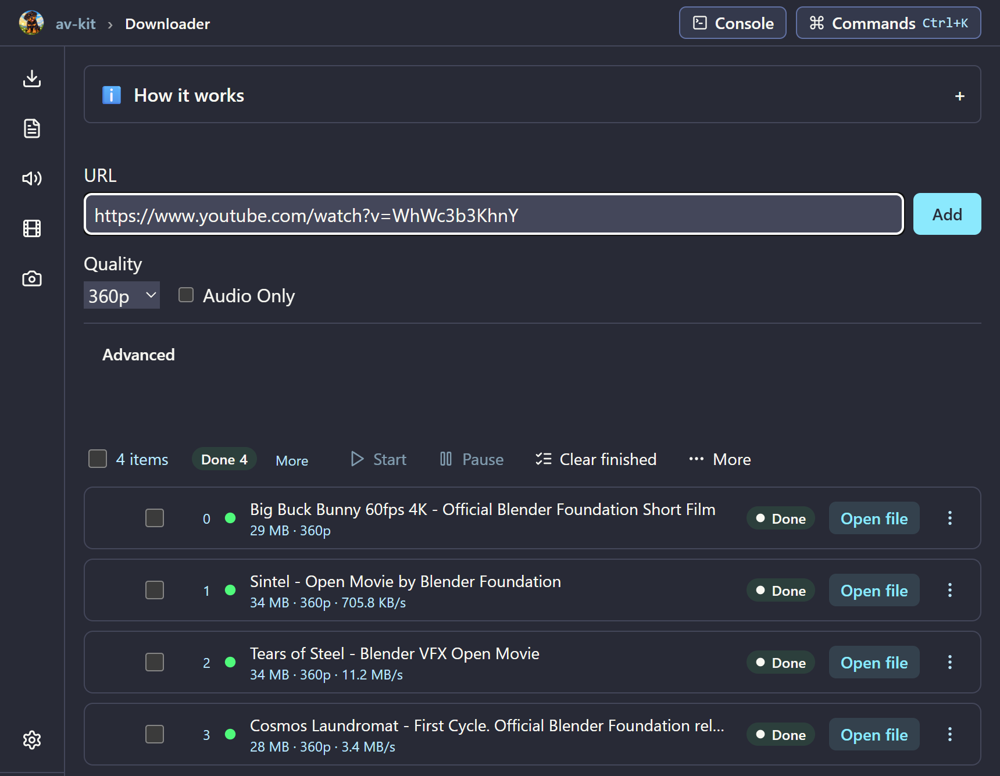
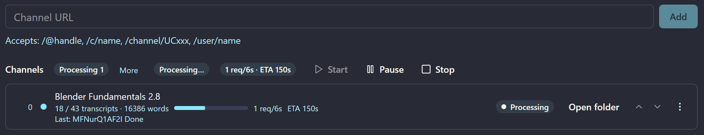
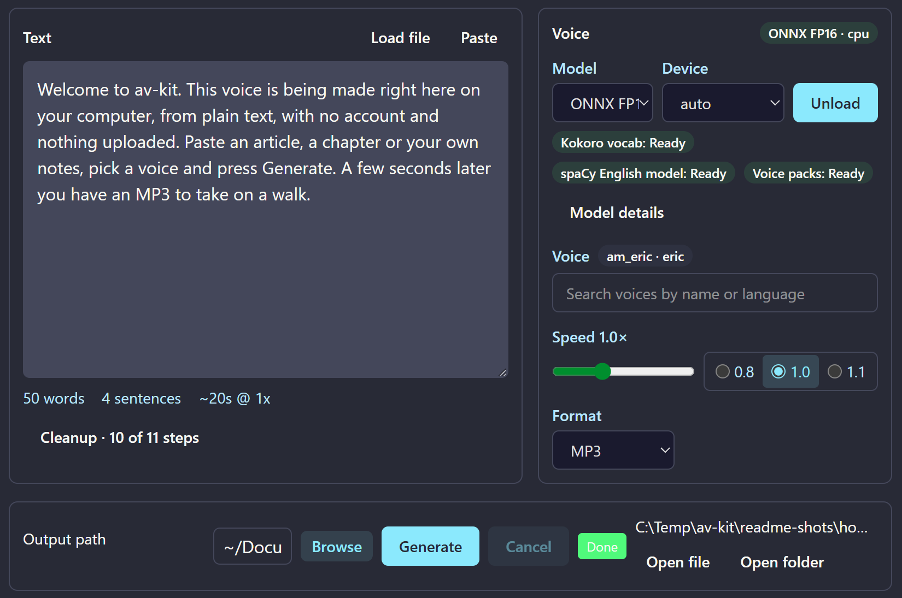
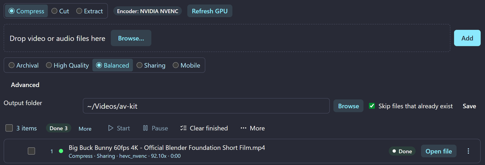
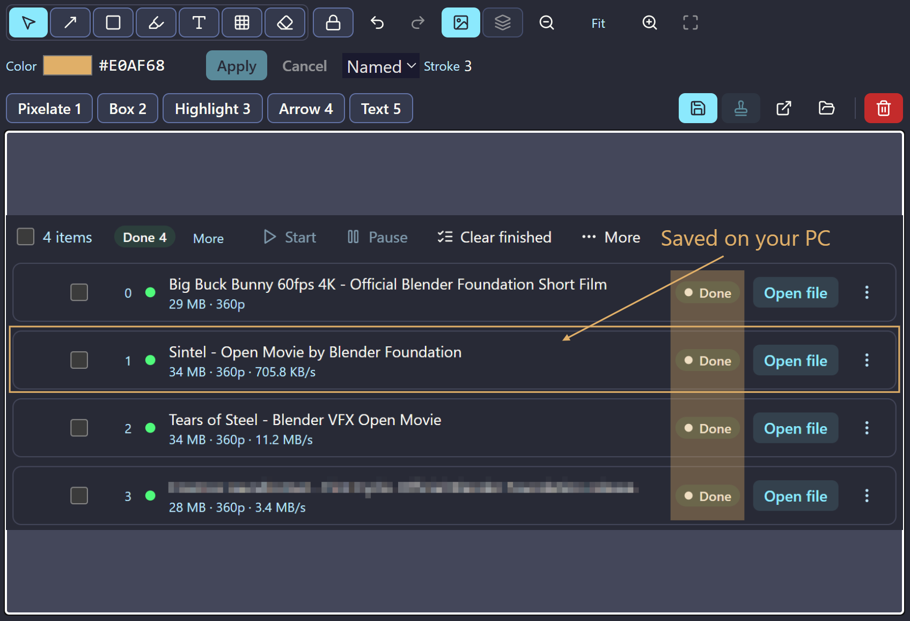
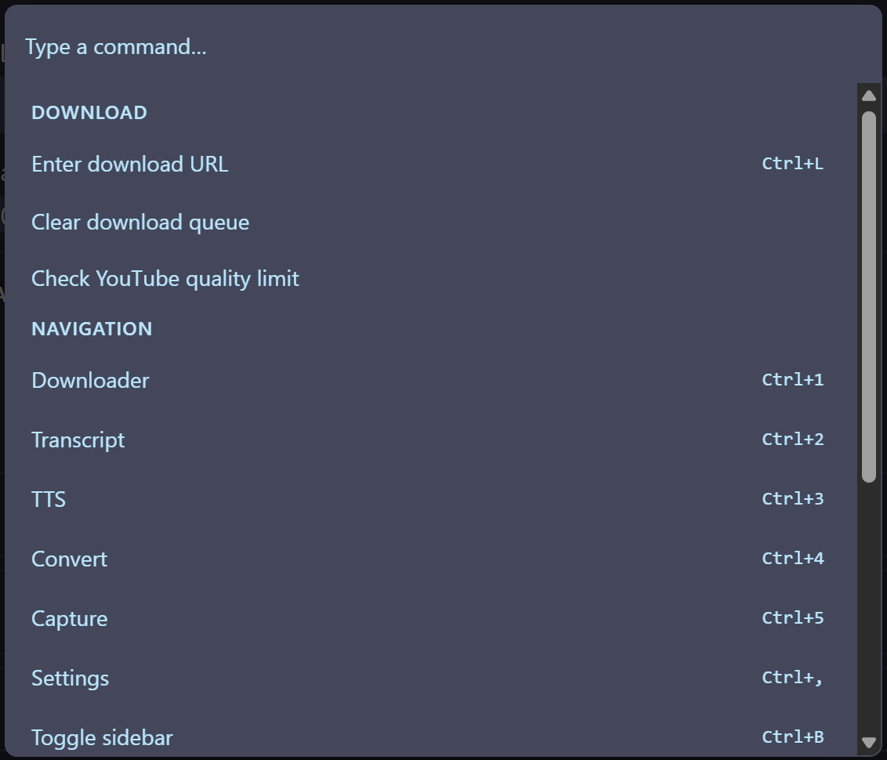

<p align="center">
  
</p>

<h1 align="center">av-kit</h1>

<p align="center">
  <b>Keep the talk. Search the transcript. Listen to your notes.</b><br>
  One friendly Windows app that saves YouTube videos and captions, reads text aloud,
  shrinks videos and marks up screenshots, all on your own PC.<br>
  No sign-up and no ads. Downloads, audio and file processing all run on your PC.
</p>

<p align="center">
  <a href="https://github.com/matbanik/av-kit/releases"><b>Download for Windows</b></a> (10 or 11, 64-bit)
  &nbsp;·&nbsp;
  <a href="#quick-start">Quick start</a>
  &nbsp;·&nbsp;
  <a href="#let-your-ai-assistant-drive-it">Use it from your AI assistant</a>
</p>

<p align="center">
  <picture>
    <source media="(prefers-color-scheme: light)" srcset="docs/images/readme/hero-light.png">
    
  </picture>
</p>

## Why av-kit?

You found a great talk. You want the video for the train, the transcript for your notes,
a short clip for a friend and a screenshot with an arrow on it. That usually means a
downloader site full of ads, a transcript tool, a converter and a screenshot app.

av-kit does all of that in one window.

- **Save a whole channel as text.** Point it at a channel or playlist and it saves each
  video's captions as a searchable text file, plus combined files sized to drop into an
  AI chat or your notes.
- **Turn an article into an MP3.** Paste text, pick a voice, press Generate. The voice runs
  on your PC's processor, so no graphics card is needed.
- **Let your AI assistant do the clicking.** Claude, Cursor, Codex and other assistant apps
  can queue downloads, fetch transcripts and make audio for you.
- **Press F2 from any app.** While av-kit is running, even tucked away in the tray, F2 grabs
  part of the screen. Add arrows, boxes, highlights or text, pixelate anything private, and save.

## Quick start

> **No installer yet.** The first release candidate is being prepared. Until it's out,
> you can [build from source](#build-from-source).

1. Download **`av-kit Setup <version>.exe`** from the [Releases page](https://github.com/matbanik/av-kit/releases).
   It runs on Windows 10 and 11 (64-bit).
2. Run it. The installer is not code-signed yet, so Windows SmartScreen may ask:
   choose **More info → Run anyway**.
3. Open av-kit, paste a YouTube link, click **Add**, then **Start**. When it finishes,
   click **Open file**.

FFmpeg comes inside the installer. Text to speech needs a one-time voice model download,
which you pick and start from inside the app; after that it works offline.

### Your first five minutes

| I want to… | Do this | Files land in |
| --- | --- | --- |
| Save a video | <kbd>Ctrl</kbd>+<kbd>1</kbd>, paste a link, **Add**, **Start** | `Downloads\av-kit` |
| Get a channel's transcripts | <kbd>Ctrl</kbd>+<kbd>2</kbd>, paste the channel link, **Add**, **Start** | `Documents\Transcripts` |
| Hear some text | <kbd>Ctrl</kbd>+<kbd>3</kbd>, **Get** and **Load** a voice model once, type, **Generate** | `Documents` |
| Shrink a video | <kbd>Ctrl</kbd>+<kbd>4</kbd>, drop the file in, pick a preset, **Start** | `Videos\av-kit` |
| Mark up a screenshot | <kbd>F2</kbd> from any app, drag a region, annotate, **Save** | `Pictures\av-kit` |

Every folder can be changed in **Settings** (<kbd>Ctrl</kbd>+<kbd>,</kbd>). Each page also has a
**How it works** panel if you get stuck.

## What it looks like

### Downloader

Paste links, pick a quality and start: that's the screen at the top. The queue shows
speed, time left and size for every file. When av-kit finds YouTube is limiting quality,
it holds those downloads and says why, instead of quietly handing you something worse.

### Channel transcripts

Add a channel or playlist and av-kit works through its videos at a gentle pace, so YouTube
isn't flooded with requests. Each video's captions become a tidy text file you can search,
quote or hand to an AI.

<p align="center">
  <picture>
    <source media="(prefers-color-scheme: light)" srcset="docs/images/readme/transcript-light.png">
    
  </picture>
</p>

Each file links back to its video. The first lines of one:

```text
So, how do we navigate Blender?
This may seem intimidating at first, but it's actually pretty simple. Let's start with the 3D Viewport.
```

### Text to speech

Type or paste text, pick a voice and press **Generate**. A few seconds later there's an
MP3 waiting, with buttons to open it or its folder.

<p align="center">
  <picture>
    <source media="(prefers-color-scheme: light)" srcset="docs/images/readme/tts-light.png">
    
  </picture>
</p>

### Convert

Shrink a video with a preset (Archival, High quality, Balanced, Sharing, Mobile), cut out
a section or pull out just the audio. FFmpeg comes in the box.

<p align="center">
  <picture>
    <source media="(prefers-color-scheme: light)" srcset="docs/images/readme/convert-light.png">
    
  </picture>
</p>

### Capture

Press <kbd>F2</kbd> from any app, drag a region, then mark it up: arrows, boxes,
highlights, text, and pixelate for anything private.

<p align="center">
  <picture>
    <source media="(prefers-color-scheme: light)" srcset="docs/images/readme/capture-light.png">
    
  </picture>
</p>

### Keyboard first

<kbd>Ctrl</kbd>+<kbd>K</kbd> opens the command palette. <kbd>Ctrl</kbd>+<kbd>1</kbd> to
<kbd>5</kbd> jump between pages and <kbd>Ctrl</kbd>+<kbd>,</kbd> opens Settings.

<p align="center">
  <picture>
    <source media="(prefers-color-scheme: light)" srcset="docs/images/readme/palette-light.png">
    
  </picture>
</p>

## Let your AI assistant drive it

av-kit includes an [MCP](https://modelcontextprotocol.io) server (MCP is the standard way
assistant apps plug in tools), so Claude Desktop, Claude Code, Cursor, Codex and others can
use it:

> "Download this talk at 720p, then get the transcripts for the whole channel."
>
> "Read this paragraph aloud and save it as an MP3."

The easy way: open **Settings → MCP** in av-kit and copy the ready-made setup prompt for
your assistant. Keep av-kit running while your assistant uses it; sitting in the tray is
enough.

<details>
<summary>Set it up by hand</summary>

Add this to your assistant's MCP config file, replacing `YOU` with your Windows user name.
For Claude Desktop that file is `%APPDATA%\Claude\claude_desktop_config.json`; for Cursor
it's `%USERPROFILE%\.cursor\mcp.json`. Codex uses a different (TOML) format, so use the
Settings → MCP prompt there.

```json
{
  "mcpServers": {
    "avkit": {
      "command": "C:\\Users\\YOU\\AppData\\Local\\Programs\\av-kit\\av-kit.exe",
      "args": ["C:\\Users\\YOU\\AppData\\Local\\Programs\\av-kit\\resources\\mcp-server\\index.mjs"],
      "env": { "ELECTRON_RUN_AS_NODE": "1" }
    }
  }
}
```

</details>

av-kit only reads from YouTube. Its assistant tools can't upload, and anything that deletes
or overwrites files asks you first. What you type to your assistant goes through that
assistant's own service, under its own privacy terms.

## Build from source

You need Windows 10 or 11 (64-bit), [Node.js](https://nodejs.org),
[uv](https://docs.astral.sh/uv/), FFmpeg on your `PATH`, and the
[.NET 8 SDK](https://dotnet.microsoft.com/download/dotnet/8.0) for the F2 region picker.

```powershell
git clone https://github.com/matbanik/av-kit.git
cd av-kit
uv sync --all-packages
cd ui
npm install
npm run build:picker
npm run dev
```

<details>
<summary>Building the installer</summary>

`npm run dist` (in `ui`) builds `ui\dist\av-kit Setup <version>.exe`. It packs three things
that must exist first:

1. **The backend:** from the repo root, `uv run python tools/package_backend.py` builds
   `packaging\dist\avkit-backend` with PyInstaller.
2. **FFmpeg:** `tools\fetch_ffmpeg_windows.ps1` downloads a pinned build into
   `packaging\ffmpeg-win64`. If the pinned link has expired, pass a current
   [BtbN win64 GPL build](https://github.com/BtbN/FFmpeg-Builds/releases) with `-Url`
   and its `-Sha256`.
3. **The MCP server's packages:** `npm install` in `mcp-server`.

</details>

## Built on

[yt-dlp](https://github.com/yt-dlp/yt-dlp) ·
[youtube-transcript-api](https://github.com/jdepoix/youtube-transcript-api) ·
[Kokoro-82M](https://huggingface.co/hexgrad/Kokoro-82M) ·
[FFmpeg](https://ffmpeg.org) ·
[FastAPI](https://fastapi.tiangolo.com) ·
[Electron](https://www.electronjs.org) ·
[React](https://react.dev)

Licenses for the bundled components are in [THIRD_PARTY_NOTICES.md](packaging/THIRD_PARTY_NOTICES.md).

## Use it kindly

av-kit is for personal use with content you have the right to save: your own uploads,
Creative Commons videos, lectures you're allowed to keep offline. Please respect creators and
YouTube's Terms of Service. av-kit never uploads anything.

## Credits

The download queue in the screenshots lists the titles of four Blender Foundation open
movies, © Blender Foundation, [blender.org](https://www.blender.org): *Big Buck Bunny*,
*Sintel* and *Tears of Steel*, released under
[CC BY 3.0](https://creativecommons.org/licenses/by/3.0/), and *Cosmos Laundromat*,
released under a Creative Commons Attribution (CC BY) license.

The transcript excerpt quotes the opening lines, unchanged, of
[*Viewport Navigation - Blender 2.80 Fundamentals*](https://www.youtube.com/watch?v=ILqOWe3zAbk)
by Blender, published on YouTube under a Creative Commons Attribution (CC BY) license.

Rottiboo, the pup, is av-kit's mascot.

## License

av-kit's own code is released under the [MIT License](LICENSE). Bundled components keep
their own licenses, listed in [THIRD_PARTY_NOTICES.md](packaging/THIRD_PARTY_NOTICES.md).
